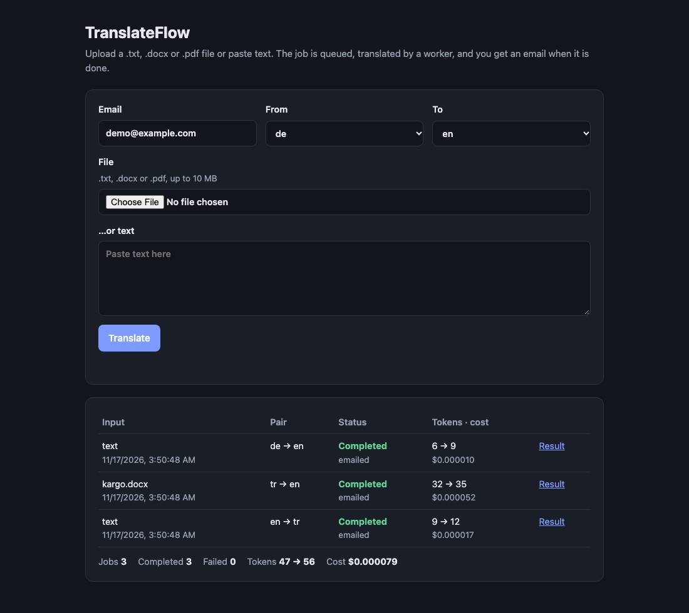
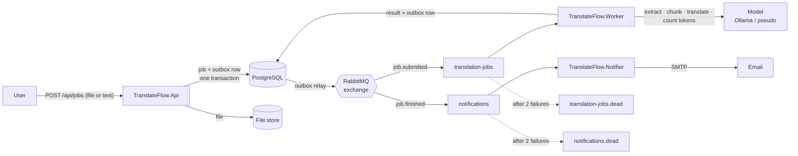

# TranslateFlow

[](https://github.com/NejatSENER/translate-flow/actions/workflows/ci.yml)

An asynchronous document translation pipeline. Upload a `.txt`, `.docx` or `.pdf` file (or paste text). The API queues the job and returns at once. A worker extracts the text, splits it into token-sized chunks, translates them with the model configured for that language pair, counts tokens and cost, and stores the result. A separate notifier service emails the user.

Three independently deployable .NET 10 services, PostgreSQL, RabbitMQ and the **transactional outbox** pattern, so a job is never lost between the database and the queue and never processed twice.



## Architecture



| Project | Role |
|---|---|
| `TranslateFlow.Api` | Validates and stores uploads, creates jobs, status, results, per-user usage, a small UI |
| `TranslateFlow.Worker` | Consumes `job.submitted`: extract, chunk, translate, count tokens, cost, store result |
| `TranslateFlow.Notifier` | Consumes `job.finished` and sends the email. Deployed on its own, like a shared mail service |
| `TranslateFlow.Core` | EF Core model, outbox relay, RabbitMQ topology and consumer, file store |
| `TranslateFlow.Processing` | Text extraction (OpenXml, PdfPig), tokenizer, chunker, translators |

## Design decisions

**Transactional outbox.** Saving a job and publishing "job submitted" are two systems; if the process dies between them, the job is either lost or announced without existing. The API saves the job and an `outbox_messages` row in **one transaction**. A relay publishes unsent rows to RabbitMQ with publisher confirms and marks them sent. The worker does the same for "job finished". Relays use `FOR UPDATE SKIP LOCKED`, so the API and the worker can both run one.

**At-least-once delivery, idempotent consumers.** The relay may publish a message twice (crash after publish, before commit), and RabbitMQ redelivers unacknowledged messages. So:
- The worker claims a job with a conditional update: `status = 'Queued'`, or a job whose previous worker died and whose **lease** ran out. A duplicate message finds nothing to claim.
- The notifier marks the job as notified before sending. A duplicate finds it already marked; a failed send removes the mark so the retry can send.
- Tested: re-publishing both messages after a job finished changes nothing and sends no second email.

**Failures are visible.** A handler that throws gets one redelivery, then the message goes to a `*.dead` queue. Unreadable messages go there at once. Expected failures (unsupported file, no text, unsupported language pair) fail the job with a clear reason, and the user gets a "failed" email.

**Model routing and cost.** A `model_routes` table maps each source and target language to a model and its price per million input and output tokens. Tokens are counted with the `o200k_base` tokenizer (`Microsoft.ML.Tokenizers`), stored per job, and summed per user at `/api/usage`, the numbers a quota or billing system would read.

**Chunking.** Text is split into chunks under a token budget on paragraph boundaries, and on sentence boundaries for paragraphs that are too long, so each model call stays inside its context window and paragraph breaks survive translation.

**Timeouts that fit an LLM.** The Ollama client uses the standard resilience handler (retry, circuit breaker, timeouts), with the per-attempt timeout raised from the default 10 seconds to 2 minutes, since a 7B model on a long chunk is slower than a typical API call.

## Running it

Everything, including the three services:

```bash
docker compose up --build
```

- UI and API: http://localhost:8080
- Emails (Mailpit): http://localhost:8026
- RabbitMQ management: http://localhost:15673 (`translateflow` / `translateflow_dev`)

By default the worker uses a **pseudo translator** that tags each paragraph (`[EN] ...`), so the pipeline runs without a model. For real translations with a local model:

```bash
ollama pull qwen2.5:7b
TRANSLATION_PROVIDER=Ollama docker compose up --build
```

To run the services from source instead, start only the infrastructure (`docker compose up -d postgres rabbitmq mailpit`) and `dotnet run` each project in `src/`.

## API

| Method | Path | Notes |
|---|---|---|
| `POST` | `/api/jobs` | multipart: `email`, `sourceLanguage`, `targetLanguage`, and `file` or `text`. `202 Accepted` |
| `GET` | `/api/jobs/{id}` | Status, model, tokens, cost, error |
| `GET` | `/api/jobs/{id}/result` | Translated text, `409` until completed |
| `GET` | `/api/jobs?email=` | A user's jobs |
| `GET` | `/api/usage?email=` | Jobs, tokens and cost for a user |
| `GET` | `/api/routes` | Supported language pairs, models and prices |

Errors are RFC 9457 problem details with a `code`: `invalid_email`, `invalid_input`, `unsupported_language_pair` (422), `unsupported_file` (415), `file_too_large` (413), `not_ready` (409).

## Tests

```bash
dotnet test   # needs Docker
```

16 tests. The end-to-end ones start PostgreSQL and RabbitMQ with Testcontainers, the API in memory, and the worker and notifier as two separate hosts:

- A text job is translated, costed, stored and emailed. A `.docx` long enough to need several chunks goes through the same path.
- A PDF without text fails with a reason and a "failed" email. Invalid requests are rejected before anything is queued.
- Duplicate `job.submitted` and `job.finished` messages translate and email once.
- A job left in `Translating` by a crashed worker is picked up again after its lease expires.
- Usage adds up tokens and cost per user.

Unit tests cover extraction from all three formats, chunking under a token budget, token counting and cost.

## Not in scope

- Authentication: the email in the request identifies the user. A real system takes it from a token.
- Blob storage: files go to a local or volume-mounted folder behind an `IFileStore` interface.
- Observability: structured logs only. OpenTelemetry traces across the three services would be the next step.
- Cleaning up old outbox rows and stored files.
- The notifier prefers a missing email to a duplicate one: if it crashes after marking a job as notified and before the SMTP call, that email is not sent. A notification lease (like the worker's job lease) would close this gap.

## License

MIT
